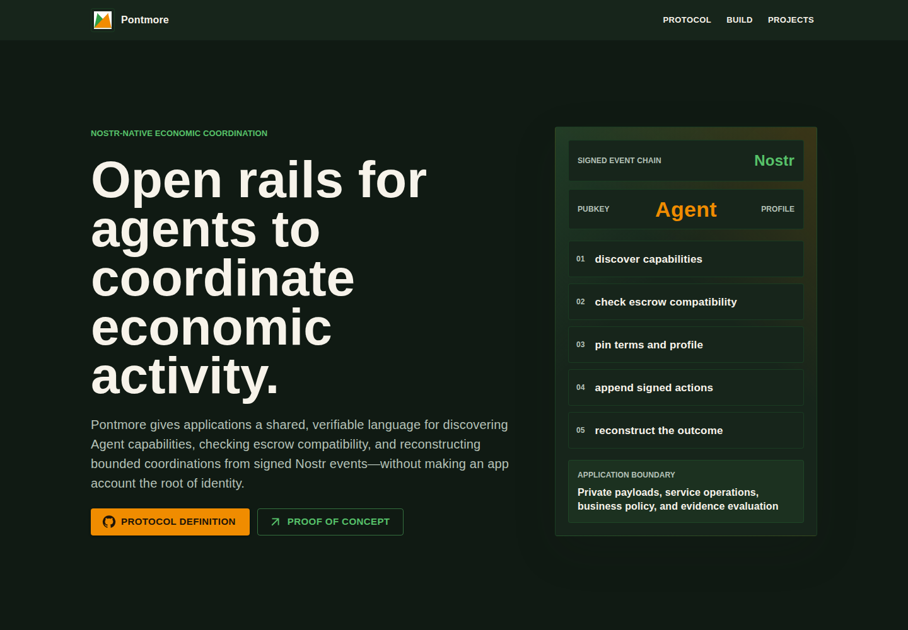
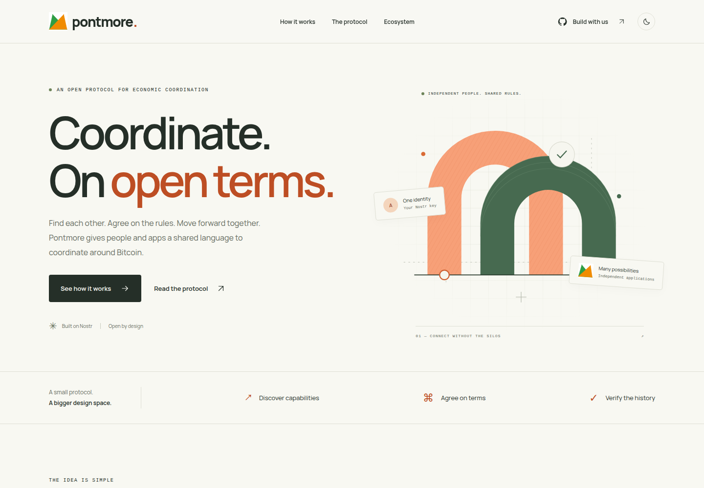
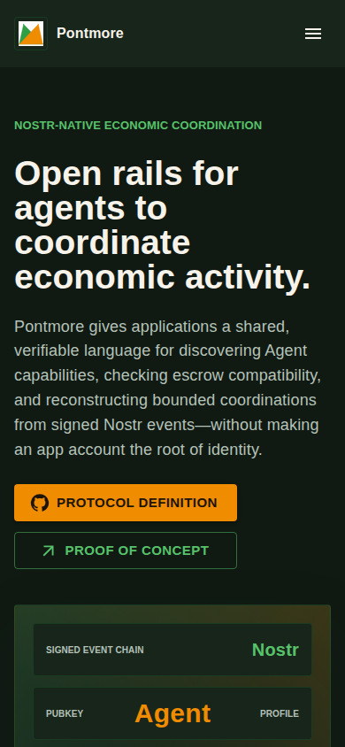
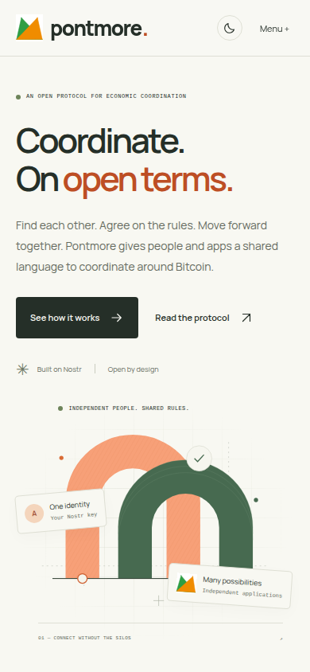
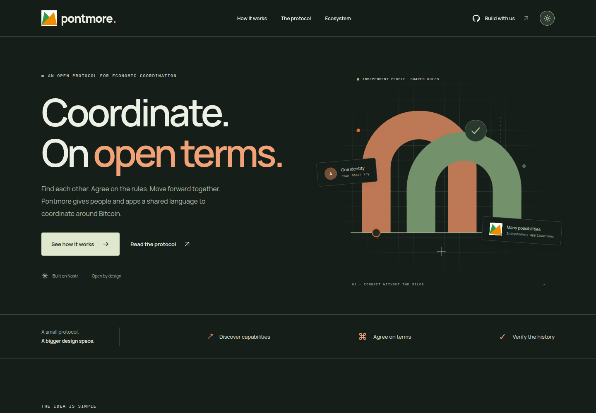
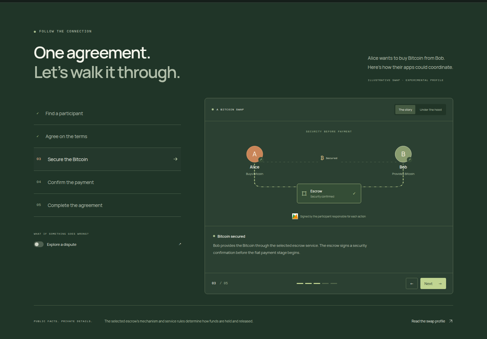

# Website redesign screenshots

These are actual local browser captures for the redesign PR, taken on 2026-10-16.

- Before: upstream `main`, commit `f8ed44497c7d5c1d79d2ce9e96e5d5900b9300d0`.
- After: the redesigned website in this change, served from its production build.
- Desktop: 1440 × 1000 CSS pixels. Mobile: 390 × 844 CSS pixels. Device scale factor: 1.
- The original site uses its existing dark palette. The new site is shown in light and dark mode.
- The walkthrough capture shows step 3, “Secure the Bitcoin,” with illustrative data.

The original source was extracted into a temporary directory; development indicators were disabled for the captures. No payments, accounts, or live protocol events were used.

| Before | After |
| --- | --- |
|  |  |
|  |  |

